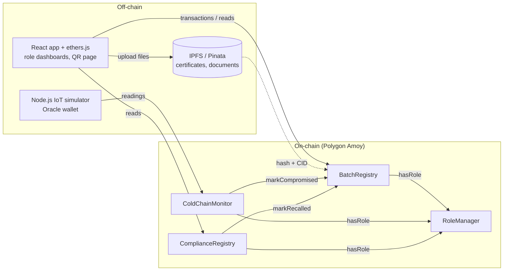
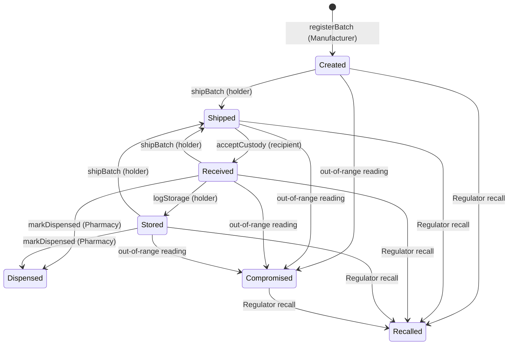

# PharmaTrace

**A blockchain-based cold chain provenance system for medicines**
CSE 540 Engineering Blockchain Applications, Fall B 2026 · Team 14

> Status: **Draft Smart Contract Design (Nov 1 milestone).** Contract interfaces, draft logic and comments are in place. Frontend, IoT simulator and IPFS service are scaffolded, not built yet.

---

## 1. Description

A medicine travels from manufacturer to distributor to pharmacy to patient. Each company keeps private records, so nobody can show the full history of a package. Counterfeits slip in, and shipments that left their safe temperature can still be sold.

PharmaTrace puts every custody transfer and temperature reading of a drug batch on a shared ledger (Polygon Amoy testnet). Smart contracts enforce the rules:

- Only the **current holder** can hand a batch on, and the **named recipient** must accept it.
- An **out-of-range temperature** reading flags the batch as `Compromised` automatically.
- A **regulator** can approve or recall a batch. A recall freezes it.
- **Anyone** can scan a QR code and see if a batch is safe, with no wallet needed.

Certificates and sensor payloads stay **off-chain** (IPFS via Pinata). Only their hashes go on-chain, for privacy and low gas cost.

## 2. Architecture



### Contracts

| Contract | Owner | Purpose |
|---|---|---|
| `RoleManager` | Shreeraj | OpenZeppelin `AccessControl`. Roles: Manufacturer, Distributor, Pharmacy, Regulator, Oracle. Regulator administers all roles. |
| `BatchRegistry` | Shreeraj | Unique batch ID, owner, lifecycle status, two-step custody transfer, custody trail. |
| `ColdChainMonitor` | Deep | Per-batch safe range, Oracle readings, automatic breach detection. |
| `ComplianceRegistry` | Tanay | Regulator approve / recall, plus `verifyForConsumer()` for the QR page. |

Interfaces live in [`contracts/interfaces/`](contracts/interfaces). Other contracts depend on interfaces only.

### Batch lifecycle



`Dispensed`, `Compromised` and `Recalled` freeze the batch: no more custody moves.

### Who can do what

| Stakeholder | Writes (transactions) | Reads |
|---|---|---|
| Manufacturer | `registerBatch`, `attachCertificate`, `setTempRange`, `shipBatch` | All records |
| Distributor | `acceptCustody`, `logStorage`, `shipBatch` | All records |
| Pharmacy | `acceptCustody`, `logStorage`, `markDispensed` | All records |
| Regulator | grant/revoke roles, `approveBatch`, `recallBatch`, `setModules` | All records, audit log |
| IoT Oracle | `recordReading` | None |
| Consumer | none | `verifyForConsumer`, batch history by QR |

### Function signatures (summary)

```solidity
// BatchRegistry
registerBatch(string drugName, string lotNumber, uint64 expiryDate, bytes32 certificateHash, string ipfsCid) returns (uint256)
attachCertificate(uint256 batchId, bytes32 certificateHash, string ipfsCid)
shipBatch(uint256 batchId, address to)
acceptCustody(uint256 batchId)
logStorage(uint256 batchId, string location)
markDispensed(uint256 batchId)
markCompromised(uint256 batchId)      // ColdChainMonitor only
markRecalled(uint256 batchId)         // ComplianceRegistry only
getBatch(uint256) / getCustodyTrail(uint256) / batchCount()

// ColdChainMonitor  (temperatures are int16 tenths of a degree C: 20 = 2.0 C)
setTempRange(uint256 batchId, int16 minTemp, int16 maxTemp)
recordReading(uint256 batchId, int16 temperature, uint64 timestamp, bytes32 payloadHash)
getTempRange / getReadingCount / getReading / hasBreach

// ComplianceRegistry
approveBatch(uint256 batchId, bytes32 reportHash)
recallBatch(uint256 batchId, string reason, bytes32 reportHash)
verifyForConsumer(uint256 batchId) returns (bool exists, bool safe, uint8 status)
```

Every state change emits an event for auditing (`BatchRegistered`, `BatchShipped`, `CustodyAccepted`, `BreachDetected`, `BatchRecalled`, ...).

## 3. Dependencies and setup

| Tool | Version |
|---|---|
| Node.js | 18 or newer |
| Hardhat + toolbox | ^2.22 / ^5 |
| OpenZeppelin Contracts | ^5.0.2 |
| Solidity | 0.8.24 |
| MetaMask | any recent (frontend, later) |
| Pinata account | for IPFS uploads (later) |

```bash
git clone https://github.com/CSE540-Team14-Project/PharmaTrace
cd PharmaTrace
npm install
cp .env.example .env        # only needed for Amoy
npx hardhat compile
npx hardhat test
```

## 4. How to use / deploy

**Local**

```bash
npx hardhat node                                  # terminal 1
npm run deploy:local                              # terminal 2, prints 4 addresses
```

**Polygon Amoy testnet** (chain id 80002)

```bash
# fill AMOY_RPC_URL and DEPLOYER_PRIVATE_KEY in .env (use a testnet-only wallet)
npm run deploy:amoy
```

`scripts/deploy.js` deploys `RoleManager` → `BatchRegistry` → `ColdChainMonitor` → `ComplianceRegistry`, then calls `setModules()` once to link them. The deployer becomes the first Regulator.

**Demo flow (target for Nov 15)**

1. Regulator grants roles to Manufacturer, Distributor, Pharmacy and Oracle wallets.
2. Manufacturer registers a batch and sets its safe range (2.0 to 8.0 C).
3. Regulator approves the batch.
4. Manufacturer ships → Distributor accepts and logs storage → ships → Pharmacy accepts.
5. Oracle posts normal readings, then one out-of-range reading → batch becomes `Compromised`.
6. Consumer scans QR → page shows **unsafe**.

## 5. Repository layout

```
contracts/
  RoleManager.sol  BatchRegistry.sol  ColdChainMonitor.sol  ComplianceRegistry.sol
  interfaces/      IRoleManager.sol  IBatchRegistry.sol  IColdChainMonitor.sol  IComplianceRegistry.sol
scripts/deploy.js          deploy + wiring
test/flow.test.js          draft smoke tests (full suite coming)
frontend/                  React app (placeholder)
offchain/iot-simulator/    Node.js sensor simulator (placeholder)
offchain/ipfs-service/     Pinata upload service (placeholder)
docs/design-notes.md       design decisions and open questions
```

## 6. Design decisions (short)

- **Two-step custody** (ship, then accept) so a batch can never be pushed onto an unwilling party.
- **Roles in one contract**, so access rules are not copied across contracts.
- **Interfaces first**: contracts talk through `I*` interfaces, so team members can work in parallel.
- **Integers for temperature** (tenths of a degree), because Solidity has no floats.
- **Hashes on-chain, files on IPFS**, for privacy and gas.
- **Polygon Amoy**: EVM compatible, low fees for frequent readings, and publicly readable for consumers.

## 7. Roadmap

| Date | Milestone |
|---|---|
| Nov 1 | Draft contract design (this repo) |
| Nov 15 | Interim demo: one working flow end to end |
| Dec 4 | Full tests, gas report, IEEE report, final recording |

## 8. Team 14

| Member | Role |
|---|---|
| Shreeraj Vijay Bhamare | Project Lead, Smart Contract Lead |
| Aarya Umesh Bhutkar | Frontend Lead |
| Deep Nayak | Off-Chain Integration Lead |
| Tanay Amit Parikh | Testing and Security Lead |
| Yadnesh Surendra Deshpande | Documentation and Demo Lead |

All code goes through a pull request approved by at least one other member.

## License

MIT
# PharmaTrace
